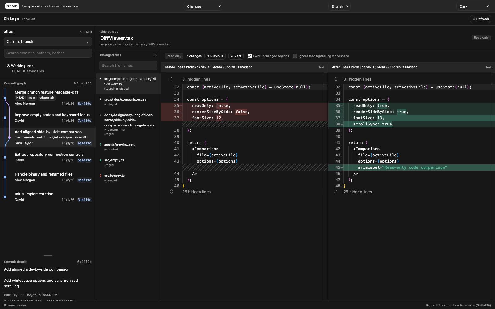

# Tienne Orca Plugins

Orca에서 사용하는 플러그인을 개발하고 관리하는 모노레포입니다. 각 플러그인은 독립적으로 빌드·설치할 수 있으며, 현재 **Git Logs**를 개발하고 있습니다.

pnpm · Nx · TypeScript · React · Vite · esbuild

## 플러그인

| 플러그인                               | 기능                                                       | 상태                   |
| -------------------------------------- | ---------------------------------------------------------- | ---------------------- |
| [Git Logs](plugins/git-logs/README.md) | 커밋 그래프, 브랜치·커밋 검색, 좌우 Diff, 커밋 우클릭 작업 | 0.1.0 · 로컬 개발 버전 |

현재 공개 릴리스와 설치 주소는 없습니다. 첫 릴리스 전까지 루트 `orca-catalog.json`은 빈 상태로 유지합니다.

## Git Logs

Git logs, Git tree visualization, commit graph, and read-only side-by-side diffs for Orca.

현재 Orca 작업 공간의 Git 이력을 사이드바에서 탐색하고, 변경 파일을 더블클릭해 중앙 탭에서 좌우로 비교합니다.

- 최근 최대 200개 커밋의 부모 관계와 HEAD, 로컬·원격 브랜치 표시
- 브랜치 필터와 메시지·작성자·해시 검색
- 줄·단어 단위 변경 강조, 동기 스크롤, 변경 이동, 변경 없는 영역 접기
- 체크아웃·브랜치 생성·병합·리베이스·체리픽·리버트·리셋
- Orca 테마 토큰과 한국어·영어 지원

Git 변경 작업은 대상과 영향을 확인한 뒤 실행합니다. Diff는 읽기 전용이며 SSH 작업 공간은 지원하지 않습니다. 비교 기준, 권한, 작업별 동작과 제한은 [Git Logs 사용 안내](plugins/git-logs/README.md)에 정리했습니다.



위 이미지는 영문 샘플 데이터를 사용하는 브라우저 DEMO입니다. 실제 저장소 정보나 Orca 호스트 화면이 아닙니다.

[라이트 테마](docs/screenshots/git-logs-light.png) · [커밋 우클릭 메뉴](docs/screenshots/git-logs-commit-menu.png) · [스크린샷 안내](docs/screenshots/README.md)

## 로컬에서 시작하기

Node.js 22.12 이상 또는 24 이상, pnpm 10, Git을 준비합니다. Orca 연결·플러그인 검증에는 Orca 데스크톱 앱과 CLI가 필요하며 Git Logs의 최소 Orca 버전은 **1.4.248**입니다.

저장소 루트에서 의존성을 설치하고 빌드합니다.

```sh
pnpm install
pnpm nx run git-logs:build
```

빌드 결과는 `dist/plugins/git-logs`입니다. UI, Monaco, 폰트, editor worker와 의존 라이선스를 포함하며 설치에 별도 node_modules가 필요하지 않습니다.

브라우저에서 샘플 화면을 확인합니다.

```sh
pnpm nx run git-logs:preview
# 소스 수정과 HMR
pnpm dev
```

미리보기 주소는 `http://127.0.0.1:4173`입니다. 영문 샘플은 `http://127.0.0.1:4173/?lang=en&sample=en`에서 볼 수 있습니다. 일반 브라우저에서는 fixture만 사용하며 실제 Git 명령을 실행하지 않습니다.

Orca에서 사용하려면 빌드 폴더의 접근 범위를 검토한 뒤 개발 플러그인으로 연결합니다. Git Logs는 사용자 계정 권한으로 Node 코드를 실행하는 `trusted-worker`이며 `workspace:read`와 `workspace:write` 권한을 사용합니다. 연결·승인 절차는 [플러그인 사용 안내](plugins/git-logs/README.md#개발)를 참고하세요.

## 검증

빌드와 검증은 Nx target으로 실행합니다.

```sh
pnpm nx run-many -t build typecheck test ui-test -p git-logs
pnpm validate
```

- `test`: 임시 Git 저장소의 조회·변경 로직, 다국어 문구, 패키징 검사
- `ui-test`: 빌드된 UI의 그래프·Diff·언어·테마·키보드·레이아웃 검증
- `validate-plugin`: 빌드 산출물의 Orca manifest 검증. `pnpm validate`로 전체 플러그인에 실행
- `screenshots`: 영문 DEMO의 라이트·다크·커밋 메뉴 PNG 생성

```sh
pnpm nx run git-logs:screenshots
```

브라우저 테스트와 캡처는 설치된 Google Chrome을 사용합니다. Chromium을 사용하려면 `pnpm exec playwright install chromium` 후 `PW_CHANNEL=chromium`을 설정하세요. 테스트 결과는 `test-results/`, 소개용 이미지는 `docs/screenshots/`에 생성됩니다.

## 저장소 구조

```text
plugins/
  git-logs/               # Git Logs 소스, manifest, 플러그인 README
    src/ui/               # 커밋 그래프, Monaco Diff, 브라우저 fixture
    src/worker/           # Git·파일 접근, 작업 확인과 실행
    showcase/             # 영문 스크린샷 캡처
scripts/                  # 독립 설치용 빌드, 테스트, 산출물 검사
docs/
  development.md          # API 연결, 검증 기록, 배포·등록 정책
  screenshots/            # 영문 DEMO 이미지와 재생성 안내
dist/plugins/git-logs/    # 빌드 결과 · Git에서 제외
orca-catalog.json         # 플러그인 카탈로그 · 첫 릴리스 전에는 비어 있음
```

`plugins/*`는 각각 독립적인 Orca 플러그인입니다. Node·파일·Git 작업은 worker에서 처리하고 UI에는 로컬 번들 에셋만 사용합니다. 플러그인 manifest는 패키징된 경로를 가리키므로 검증 대상은 소스 폴더가 아닌 `dist/plugins/*`입니다.

## 배포 현황과 문서

아직 공개 배포하지 않았습니다. 릴리스 시 빌드 결과물을 Git 저장소에 포함하고, 카탈로그에서 플러그인 하위 경로와 정확한 커밋·contentHash를 지정해야 합니다. 사용자는 배포된 카탈로그를 Orca에 추가해 설치하게 됩니다.

- [Git Logs 기능·사용법·권한](plugins/git-logs/README.md)
- [개발·검증 기록과 배포 정책](docs/development.md)
- [영문 스크린샷과 재생성 방법](docs/screenshots/README.md)

## 라이선스

[MIT](LICENSE). 함께 배포하는 의존성의 라이선스는 각 플러그인 빌드 결과의 `licenses/`에 포함됩니다.
