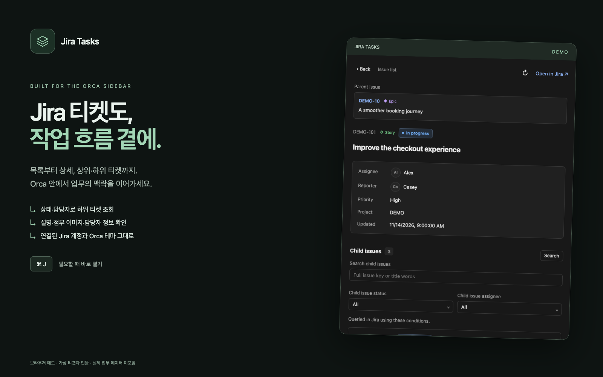
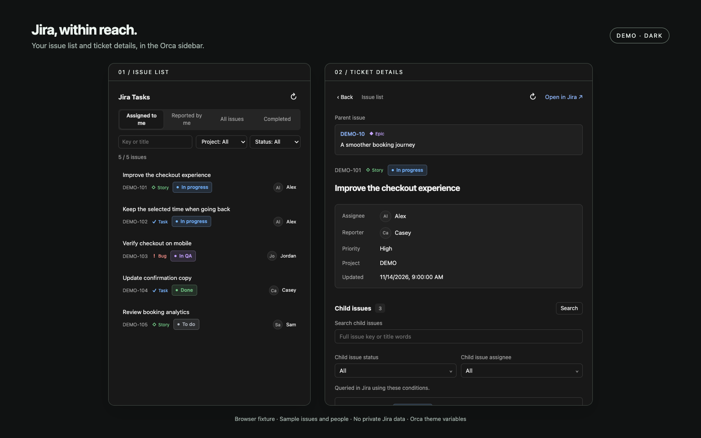
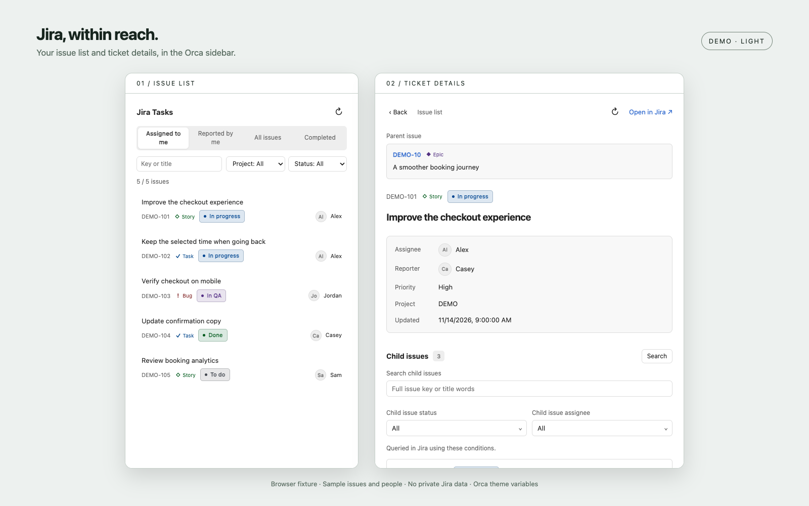

# Jira Tasks

[English](README.md) · 한국어



## Jira 티켓도, 작업 흐름 곁에.

목록부터 상세, 상위·하위 티켓까지 Orca 사이드바에서 확인하세요. 연결된 Jira 계정을 그대로 쓰고, 상태·담당자로 하위 티켓을 조회하며 ⌘J로 바로 열 수 있습니다.

Orca 작업 화면에 연결해 둔 Jira 계정으로 오른쪽 사이드바에서 티켓을 조회합니다. 별도 Jira 토큰을 요청하거나 복사하지 않습니다.

## 플러그인 정보

| 항목           | 정보                                                          |
| -------------- | ------------------------------------------------------------- |
| 제작자         | [Tienne](https://github.com/tienne)                           |
| 버전           | 0.1.0 (로컬 시제품·미배포)                                    |
| 라이선스       | MIT                                                           |
| 최소 Orca 버전 | 1.4.256                                                       |
| 기본 단축키    | macOS ⌘J · 그 외 Ctrl+J                                       |
| 소스 코드      | [tienne/orca-plugins](https://github.com/tienne/orca-plugins) |
| 계정 연결      | Orca 작업에 연결된 Jira 계정 사용                             |

## 화면 미리보기

공개 데모 티켓과 가상 인물로 캡처한 브라우저 화면입니다. 실제 Jira 데이터나 Orca 호스트 캡처가 아닙니다. DEMO 표시를 유지하세요.





## 사용

오른쪽 액티비티 바에서 **Jira Tasks**를 엽니다. Jira 연결이 하나면 자동으로 사용하고 사이트 선택창을 숨깁니다. 여러 사이트가 연결되어 있으면 사이트를 선택할 수 있습니다. 상단의 작은 버튼에서 내 담당·내가 등록·전체 티켓·완료를 선택하며, 검색·프로젝트·상태는 압축된 필터 바에서 조절합니다. 좁은 사이드바에서는 필터 바가 줄바꿈됩니다. 불러온 티켓의 번호·제목을 검색하거나 프로젝트·상태로 필터링할 수 있습니다. 조회 범위를 바꿔도 검색어는 유지하며, 새로 불러온 목록에 같은 프로젝트·상태가 있으면 선택도 유지합니다. 새 목록에 없는 프로젝트·상태만 전체로 초기화하고, Jira 사이트를 바꿀 때는 목록 검색 조건을 초기화합니다. 큰 상태 분류가 아니라 실제 상태 이름에 따라 텍스트와 배지 색상을 나눕니다. IN PROGRESS는 파랑, IN QA는 보라, PR·리뷰는 청록, HOLD는 주황, BLOCKED는 빨강, DONE은 초록, BACKLOG는 회청색으로 표시하고 그 밖의 상태도 이름별로 일정한 색상을 사용합니다. 티켓 유형은 상태와 별도로 심볼·이름이 있는 배지로 표시합니다. Bug는 빨강, Task는 파랑, Story는 초록, Epic은 보라, Sub-task는 청록이며 Bug 하위 작업은 버그 색상을 사용합니다. 사용자 정의 유형도 이름별로 일정한 색상을 표시하고 목록·상세·상위 항목·하위 목록에 동일하게 적용합니다. 색상은 Orca 테마의 밝기를 따르며 상태 이름도 함께 표시합니다. 티켓을 선택하면 설명·담당자·우선순위를 확인하고 Jira 원문을 열 수 있습니다. 상위 항목이 있으면 상세 화면 위쪽에 번호·제목·항목 유형을 표시하며, 선택하면 사이드바에서 상위 티켓 상세를 엽니다. 상세 정보에는 담당자와 구분된 보고자 프로필 사진·이름을 표시하고, 보고자 정보를 받지 못하면 정보 없음으로 표시합니다. 메인 목록과 상세 정보에는 담당자 프로필 사진·이름을 표시하며, 사진이 없으면 이름 앞글자, 담당자가 없으면 미지정으로 표시합니다.

### 하위 항목 조회

하위 항목은 불러온 목록 안의 필터가 아니라 **Jira의 전체 직접 하위 티켓에 조건을 적용하는 조회**입니다. 전체 티켓 번호 또는 제목 단어를 입력하고 상태·담당자를 여러 개 선택한 뒤 **조회** 또는 Enter를 누릅니다. 다른 조건을 바꿔도 기존 선택은 유지합니다. 같은 항목 안의 여러 선택은 OR, 검색어·상태·담당자 사이는 AND로 적용합니다. 제목은 Jira의 단어 색인과 마지막 단어의 접두어로 검색하며 임의의 부분 문자열 검색과는 다릅니다.

최대 100개 제한은 **조회 조건을 적용한 결과**에 적용하므로 처음 100개 밖의 하위 티켓도 조회할 수 있습니다. 결과 개수를 표시하고 한도에 닿으면 조건을 좁히도록 안내합니다. **조건 초기화**는 조건을 비운 뒤 다시 조회합니다. 결과가 없어도 조회 조건은 계속 바꿀 수 있습니다. 상태·담당자 선택지도 첫 결과 페이지에 한정하지 않고 추가 Jira 조회로 찾습니다. 선택지를 모두 확인하지 못한 경우에는 그 상태를 표시하며, 번호·제목 조회는 계속 사용할 수 있습니다.

하위 티켓을 누르면 상세로 이동합니다. 상세의 새로고침은 현재 조건으로 티켓과 하위 목록을 다시 조회하고, 목록의 새로고침은 연결과 메인 목록을 갱신합니다.

메인 목록은 최대 100개를 불러옵니다. 메인 목록의 검색·프로젝트·상태 필터는 불러온 목록에만 적용하며 Jira 전체를 검색하지 않습니다. 긴 제목과 설명은 패널 표시 제한에 맞춰 일부만 표시합니다. 전체 내용은 **Jira에서 열기**로 확인하십시오. 본문 구역 사이에 여백을 두고 제목·문단·중첩 목록·링크를 표시합니다. Orca가 전달한 PNG·JPEG·WebP 이미지는 본문에 표시하며 클릭하면 사이드바 안에서 확대합니다. HTML 패널은 Orca 테마 변수를 사용해 테마 변경을 따릅니다. 이미지는 메모리에서만 관리하고 플러그인 패키지에 저장하지 않습니다. 상세 응답당 이미지 최대 8개, base64 전체 720,000자·개별 600,000자까지 표시하며, 형식이나 크기 제한을 넘는 이미지는 캡션을 표시하고 Jira 원문에서 확인하도록 안내합니다. 본문 미리보기는 24,000자로 제한합니다. 조회 데이터는 패널이 열린 동안 메모리에서만 관리하며 플러그인 저장소에 기록하지 않습니다.

Orca 작업 화면을 그대로 넣은 것이 아니라 Jira를 별도로 보여 주는 화면입니다. 티켓 변경, 작업 공간 생성, 에이전트 실행 기능은 없습니다. 단축키 명령은 이 패널을 선택하기 위해 `orca plugin open`도 실행합니다.

프로필 사진은 화면에 보일 때 워커가 공개 Atlassian 아바타 호스트에서 인증 정보 없이 읽어오며 메모리에 5분간 캐시합니다. 요청은 5초 후 중단하고 리다이렉트와 64 KiB를 넘는 파일은 받지 않으며 PNG·JPEG·WebP만 표시합니다. 사진이 없거나 불러오지 못하면 이름 앞글자를 표시하고, 담당자가 없으면 미지정으로 표시합니다.

상단의 **뒤로가기**는 방문한 상세 화면을 역순으로 돌아가며 하위 티켓 조회 조건·결과·스크롤 위치를 복원합니다. 첫 상세에서 누르면 목록으로 돌아갑니다. 옆의 **목록으로**는 어느 상세에서든 바로 목록으로 이동하고 방문 기록을 비웁니다. 상세 화면 기록은 메모리에 최대 30개 보관하며 새로고침은 기록을 추가하지 않습니다.

## 언어

영어가 기본입니다. 패널을 열 때 Orca 언어를 읽어 `ko`, `ko-*`이면 화면 문구와 날짜를 한국어로 표시하고, 그 외 언어는 영어로 표시합니다. Jira 제목·본문·상태명은 Jira 원문을 유지합니다. Orca 언어를 바꾼 뒤에는 패널을 다시 열거나 다시 불러오면 적용됩니다. 플러그인 목록 설명·manifest 커버·화면 프리뷰는 영어로 제공합니다. [영문 안내](README.md)와 별도로 이 한국어 안내 및 한국어 소개 이미지도 패키지에 포함합니다. 현재 Orca manifest는 언어별 목록 설명·커버 자동 선택을 지원하지 않습니다.

## 단축키

로컬 시제품은 명령 팔레트와 **설정 → 단축키 → 플러그인**에 **Open Jira Tasks** 명령을 추가합니다. 기본 단축키는 **macOS에서 ⌘J**, **그 외 환경에서 Ctrl+J**입니다. `Jira Tasks`로 검색해 원하는 키로 변경할 수 있습니다. 명령은 Jira Tasks 사이드바 탭을 선택하고 닫힌 사이드바를 엽니다. 작업 공간이 열려 있어야 하며 로컬 개발 식별자 `local.jira-tasks`를 사용합니다. 티켓은 변경하지 않습니다.

## 요구 사항과 권한

- Orca 1.4.256 이상과 같은 버전의 CLI가 로컬 데스크톱 호스트에 설치되어 있어야 합니다.
- Orca 작업 화면에서 Jira가 연결되어 있어야 합니다.
- 사용자 계정 권한으로 Node 워커를 실행할 승인이 필요합니다. 워커는 인자 배열로 `orca jira connection`, `orca jira list`, `orca jira issue`, `orca jira search`만 실행하며 실행 호스트를 명시적으로 로컬로 지정합니다. Jira 인증 정보는 읽지 않습니다.

`ORCA_CLI_COMMAND`가 있으면 우선 사용합니다. 없으면 macOS 기본 설치 경로의 앱 CLI, Linux의 `orca-ide`, 그 외 호스트의 `orca`를 사용합니다. 첫 버전에서는 원격 호스트의 Jira 연결과 원격 플러그인 실행을 지원하지 않습니다. 저장된 사이트와 이메일로 계정을 구분하며 플러그인이 로그인을 수행하지 않습니다.

## 개발과 검증

저장소 루트에서 pnpm 의존성과 Orca CLI를 설치한 뒤 실행합니다.

```sh
pnpm nx run jira-tasks:build
pnpm nx run jira-tasks:typecheck
pnpm nx run jira-tasks:test
pnpm nx run jira-tasks:ui-test
pnpm nx run jira-tasks:validate-plugin
```

빌드 결과는 `dist/plugins/jira-tasks`에 생성합니다. 소스 manifest는 패키징된 경로를 가리키므로 빌드 결과를 검증하십시오. 타입 검사는 설치 버전과 일치하는 `.orca/types`를 로컬에 생성합니다. 단위 테스트에는 가짜 CLI 응답을, 브라우저 테스트에는 공개 가능한 DEMO 데이터만 사용합니다.

로컬에서 사용하려면 `orca plugin inspect dist/plugins/jira-tasks --json`으로 권한을 확인한 뒤 `orca plugin dev load dist/plugins/jira-tasks --json`으로 로드합니다. Orca가 실행 승인을 요구하면 권한을 확인한 뒤 해당 fingerprint를 승인하십시오. `orca plugin open local.jira-tasks --panel jira-tasks --json`으로 패널을 엽니다. 이 플러그인은 로컬 시제품이며 카탈로그에 배포하지 않았습니다.

## 프리뷰 이미지 다시 만들기

`pnpm nx run jira-tasks:screenshots`로 `assets/`의 1600 × 1000 영어·한국어 소개 커버(내부 UI는 모두 영어), 다크·라이트 프리뷰, 256 × 256 아이콘을 다시 만듭니다. 실제 번들 패널을 Chrome에서 열고 공개 fixture와 가짜 Orca/Jira API로 캡처합니다. 소개 이미지는 로컬 HTML/CSS와 직접 그린 layers 심볼로 구성하며 외부 글꼴이나 생성형 UI를 쓰지 않습니다. 이후 `pnpm nx run jira-tasks:build`로 다시 빌드하고 `pnpm nx run jira-tasks:validate-plugin`으로 검증합니다. 설치 후에도 README 이미지가 표시되도록 패키지에 포함합니다. 이미지를 생성해도 플러그인이 공개 배포되지는 않습니다.
