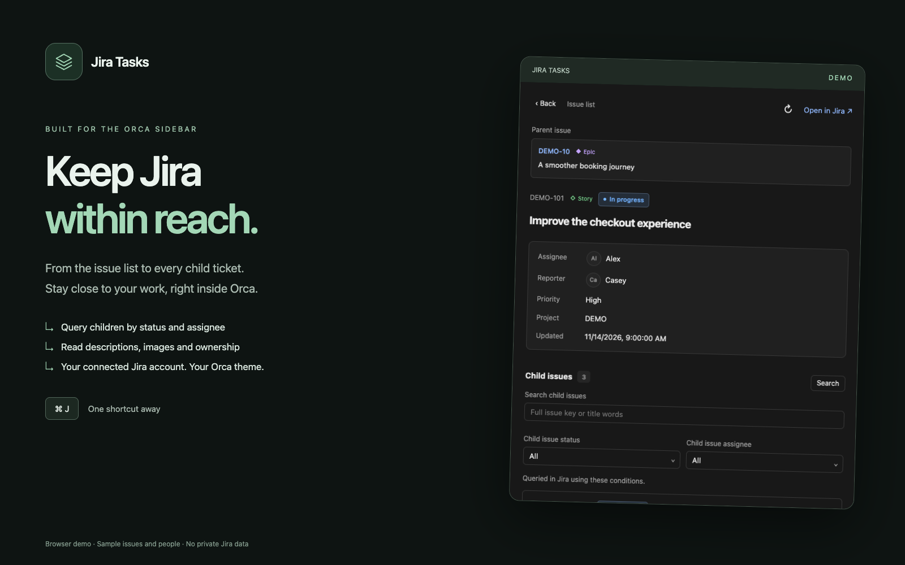
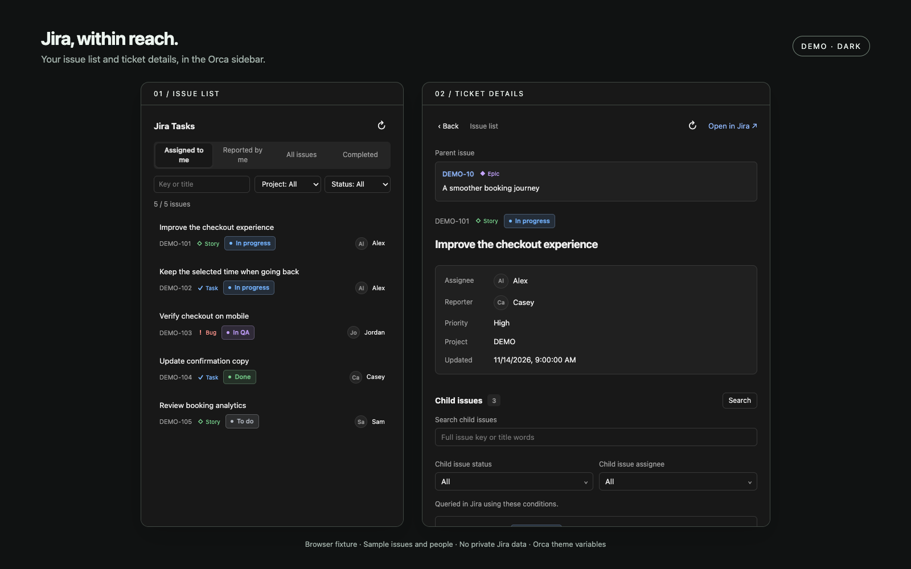
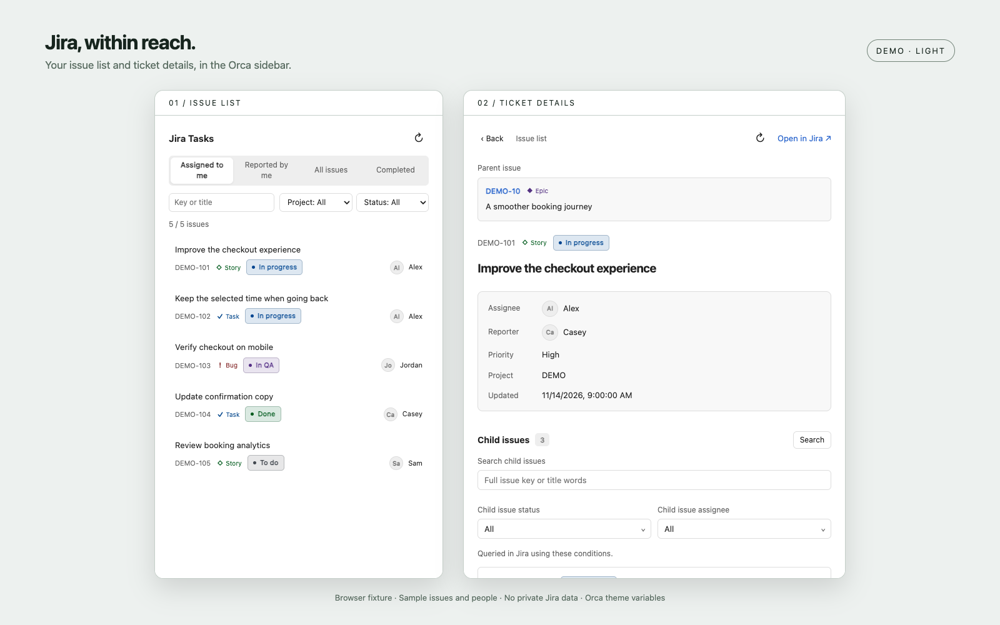

# Jira Tasks

English · [한국어](README.ko.md)



## Keep Jira within reach.

From your issue list to every child ticket, stay close to your work in the Orca sidebar. Use your connected Jira account, query children by status or assignee, and open the panel with ⌘J.

Browse Jira issues in Orca's right sidebar using the Jira accounts already connected in Orca Tasks. No separate Jira token is requested or copied.

## Plugin information

| Field                | Value                                                         |
| -------------------- | ------------------------------------------------------------- |
| Author               | [Tienne](https://github.com/tienne)                           |
| Version              | 0.1.0 (local prototype; not published)                        |
| License              | MIT                                                           |
| Minimum Orca version | 1.4.256                                                       |
| Default shortcut     | ⌘J on macOS; Ctrl+J elsewhere                                 |
| Source               | [tienne/orca-plugins](https://github.com/tienne/orca-plugins) |
| Connection           | Uses Jira accounts connected in Orca Tasks                    |

## Preview

Browser captures use sample issues and people. They contain no private Jira data and are not captures of the Orca host. Keep the DEMO labels.





## Use

Open **Jira Tasks** from the right activity bar. A single connected Jira site is selected automatically and its picker is hidden. With multiple connections, choose a Jira site. The compact scope buttons offer: assigned to you, reported by you, all issues, or completed issues. Search the loaded issues by key or title, and filter by project or status. Changing the list scope keeps the search text and project/status choices that still occur in the new loaded list. Only unavailable project/status choices reset to All; changing Jira sites resets list filters. Status text and badge colors distinguish workflow names: blue for IN PROGRESS, purple for IN QA, cyan for PR/review, amber for HOLD, red for BLOCKED, green for DONE, and muted blue-gray for BACKLOG. Other names receive a stable color derived from the name. Issue types have a separate symbol-and-name badge: Bug is red, Task blue, Story green, Epic purple, and Sub-task cyan. Bug sub-tasks keep the Bug color; custom types receive a stable name-based color. The same badges appear in the main list, detail, parent link and child rows. Colors adjust to the Orca theme; the status text stays visible. Select an issue to see its description, assignee and priority, or open it in Jira. The detail header shows the parent issue key, title and issue type when available; select it to open that parent in the sidebar. The main list and detail show each assignee's name and profile photo. Detail properties show the reporter separately, with a profile photo or initials; missing reporter data is labeled Not available. Missing or unavailable photos show initials; unassigned issues show Unassigned.

### Query child issues

The child section searches **Jira's full set of direct children**, rather than filtering a previously loaded page. Enter a full issue key or title words, select one or more statuses and assignees (including Unassigned), then press **Search** or Enter. Status and assignee selections stay selected while editing other conditions. Multiple choices within one field use OR; search, status and assignee fields combine with AND. Jira's title search uses indexed words and a final-word prefix, not arbitrary substring matching.

The result limit of 100 applies **after** Jira applies the query conditions. A matching child outside the original first 100 can therefore appear. The section shows the returned count; at the limit it asks you to narrow the query. Reset query clears conditions and queries again. Empty results leave the controls available. Status/assignee choices are discovered across children through additional bounded Jira queries, not just the initial result page; if discovery is incomplete, the UI labels it and key/title search remains usable.

Select a child to open its detail. Back retraces visited details and restores each view's query conditions, results and scroll position; from the first detail it returns to the list. Issue list returns directly to the list and clears history. Up to 30 snapshots are held in memory. Refresh reloads the current issue and its children using the current conditions without adding a history entry. The list's Refresh reloads connections and the main issue list.

The main list loads up to 100 issues. Its search, project and status filters apply only to that loaded list; they are not a full Jira search. Long titles and descriptions are shortened to fit Orca's panel limits. The full issue remains available through **Open in Jira**. Descriptions show separate sections with extra spacing, paragraphs, nested lists and links. Inline PNG, JPEG and WebP attachments supplied by Orca appear in the description; click an image to enlarge it within the sidebar. The HTML panel uses Orca theme variables and follows theme changes. Images stay in memory and are never written into the plugin package. A detail response transfers up to eight images totaling 720,000 base64 characters, with at most 600,000 characters per image; unsupported or oversized images show a caption and remain available in Jira. Text previews are limited to 24,000 characters. Data is held in memory while the panel is open; it is not written to plugin storage.

This is an independent view of Jira, not an embedded copy of Orca's Tasks screen. It does not change issues, create workspaces or launch agents. The shortcut command additionally runs `orca plugin open` to select this panel.

## Language

English is the default. When the panel opens, it reads Orca's UI language: `ko` and `ko-*` use Korean labels and date formatting; all other languages use English. Jira titles, descriptions and workflow names remain as written in Jira. After changing Orca's language, reopen or reload the panel to apply it. The plugin listing description, manifest cover and all screen previews are English. A [Korean guide](README.ko.md) and Korean introduction artwork are also bundled; Orca's current manifest does not support selecting listing metadata or cover images by locale.

## Keyboard shortcut

The local prototype contributes **Open Jira Tasks** to Orca's command palette and **Settings → Keyboard shortcuts → Plugins**. The default shortcut is **⌘J on macOS** and **Ctrl+J elsewhere**. Search for `Jira Tasks` to customize it. The command selects the Jira Tasks sidebar panel and opens the sidebar if needed. A workspace must be open. It uses the local development identity `local.jira-tasks` and does not change issues.

Profile photos load on demand from public Atlassian avatar hosts through the worker without Jira credentials. Requests time out after five seconds, reject redirects and files over 64 KiB, and accept PNG, JPEG or WebP only. Photos are cached in worker memory for five minutes.

## Requirements and access

- Orca 1.4.256 or later, with its matching CLI installed on the local desktop host.
- A Jira connection configured in Orca Tasks.
- Approval to run a trusted Node worker with your user account's access. The worker runs only `orca jira connection`, `orca jira list` `orca jira issue` and `orca jira search`, using argument arrays and explicitly selecting the local execution host. It does not read Jira credentials.

`ORCA_CLI_COMMAND` takes precedence when available. Otherwise the worker uses the standard macOS application CLI when installed there, `orca-ide` on Linux, or `orca` on other hosts. Remote-host Jira connections and remote plugin execution are not supported in this first version. Jira accounts are selected by their saved site and email; the plugin does not perform sign-in.

## Develop and verify

From the repository root, with pnpm dependencies and the Orca CLI installed:

```sh
pnpm nx run jira-tasks:build
pnpm nx run jira-tasks:typecheck
pnpm nx run jira-tasks:test
pnpm nx run jira-tasks:ui-test
pnpm nx run jira-tasks:validate-plugin
```

The build is self-contained in `dist/plugins/jira-tasks`. Source manifests name packaged entries; validate the build. Typecheck regenerates the version-matched `.orca/types` locally. Unit tests use fake CLI results; browser tests use public DEMO fixtures, not your Jira account.

For local loading, inspect the artifact with `orca plugin inspect dist/plugins/jira-tasks --json`, then use `orca plugin dev load dist/plugins/jira-tasks --json`. Review any execution approval Orca requests before approving its exact fingerprint. Open `local.jira-tasks` with `orca plugin open local.jira-tasks --panel jira-tasks --json`. This plugin is a local prototype and has not been published to a catalog.

## Rebuild preview assets

Run `pnpm nx run jira-tasks:screenshots` to regenerate the 1600 × 1000 English/Korean introduction covers (both with English UI), dark/light preview compositions and 256 × 256 icon in `assets/`. The previews capture the real bundled panel in Chrome with fixed public fixtures and mocked Orca/Jira APIs. Introduction artwork uses local HTML/CSS and a hand-drawn layers emblem; it uses no external fonts or generated UI. Rebuild afterward with `pnpm nx run jira-tasks:build` and validate with `pnpm nx run jira-tasks:validate-plugin`. Assets are bundled so README links work after installation. This does not publish the plugin.
